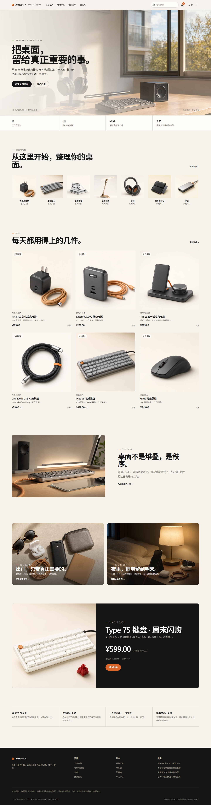
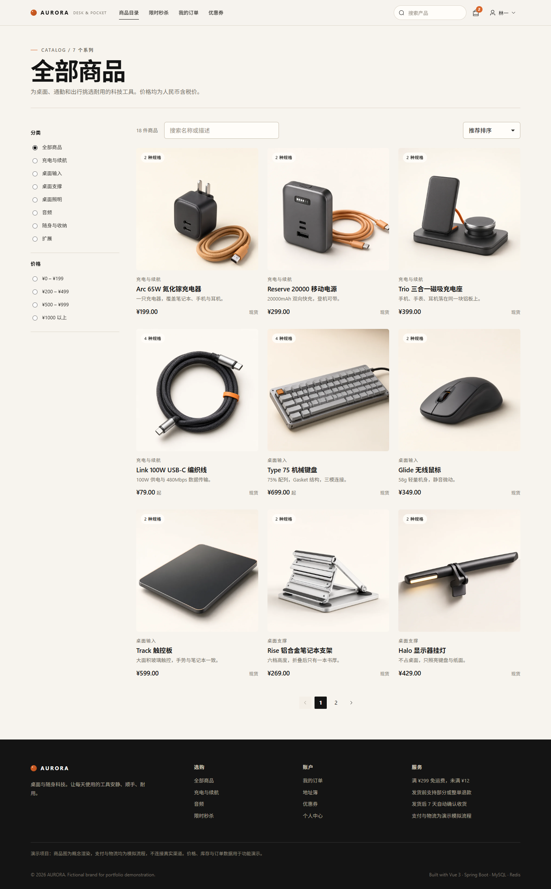
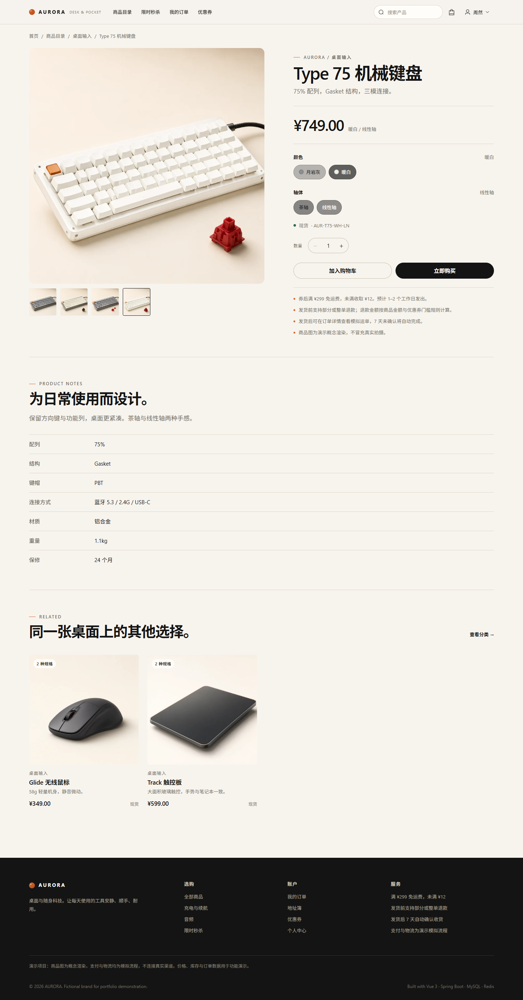
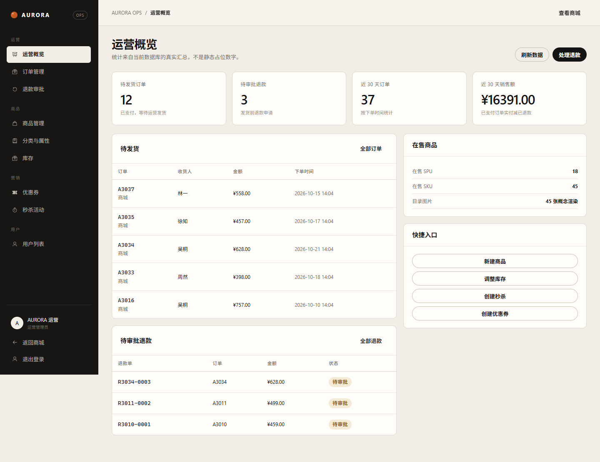
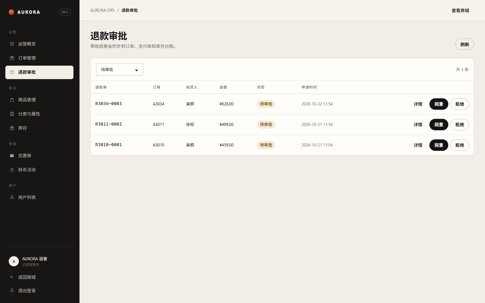
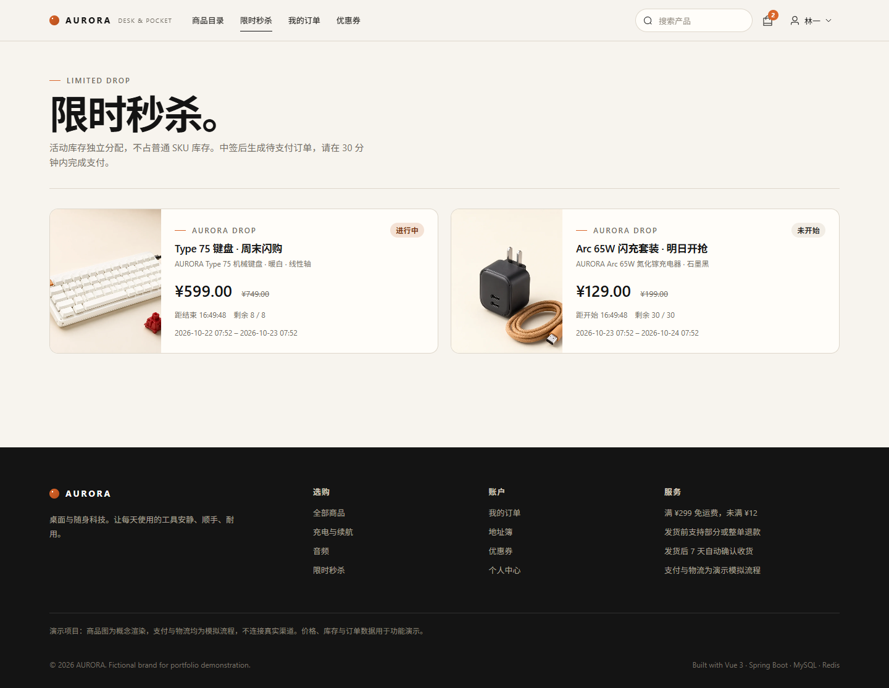
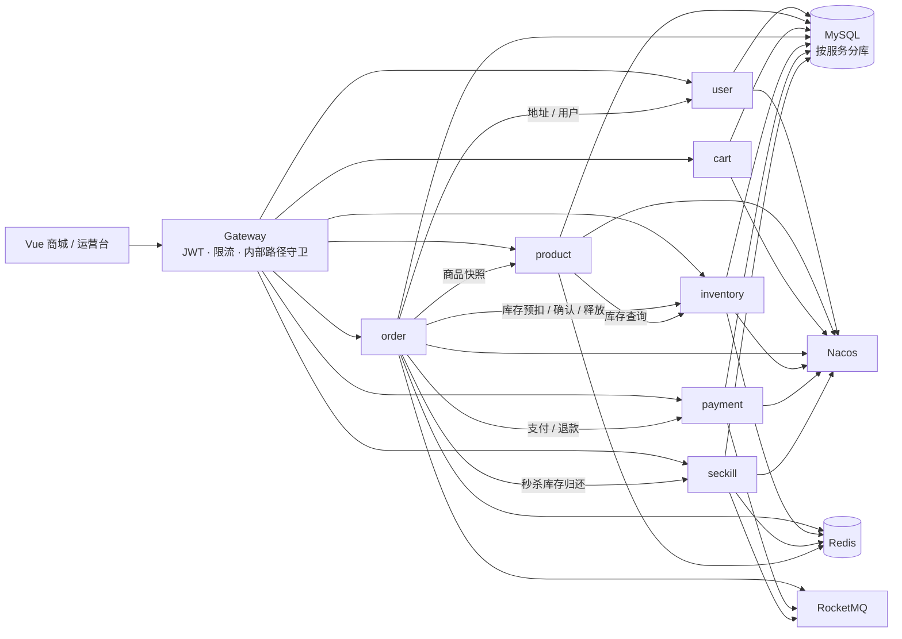
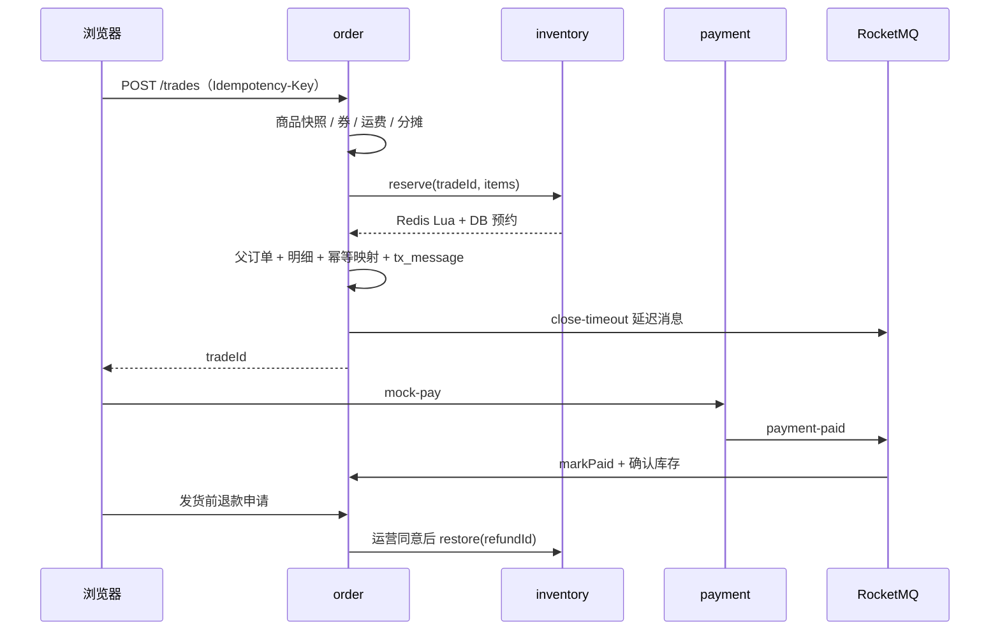

# AURORA Mall

AURORA 是一个消费电子品牌 DTC 电商项目：商城前台、独立运营台、七个 Spring Boot 业务服务，以及可复现的 MySQL / Redis 交易链路。

商品定位是桌面与随身科技。演示数据包含 18 个 SPU、45 个 SKU、37 笔历史订单和 3 场秒杀。支付与物流是模拟流程，商品图为概念渲染，不是实拍。

[](https://github.com/zeng-bohan/aurora-mall/actions/workflows/ci.yml)


## 界面

| 商城首页 | 商品目录 |
| --- | --- |
|  |  |

| 商品详情 | 运营概览 |
| --- | --- |
|  |  |

| 退款审批 | 秒杀 |
| --- | --- |
|  |  |

移动端截图在 [docs/screenshots](docs/screenshots)，文件名以 `-390` 结尾。

## 业务模型

交易对象是**父订单**。一次结算生成一张父订单，对应一次支付和一次发货；订单明细按 SKU 记录商品快照、数量、分摊后的优惠与退款金额。库存、支付、退款、秒杀都围绕父订单工作。

商品使用全局 EAV：

- `product_category`：7 个分类。
- `product_attribute` / `product_attribute_value`：15 个属性、54 个值，带类型、单位、可筛选、变体、必填与展示标记。
- `product_spu` / `product_spu_attribute` / `product_spu_attribute_value`：SPU 与参数绑定。
- `product_sku` / `product_sku_attribute`：SKU 与属性组合。组合键唯一，SKU 编码唯一。

金额规则集中在一个定价服务里：

1. 所有金额按整数分计算，落库为两位小数。
2. 优惠券按商品金额占比分摊，余数用最大余数法补齐，分摊总额必须等于券面额。
3. 券后金额满 299 元免运费，未满收 12 元。
4. 部分退款只退所选商品的原始商品金额，不退运费；退款后剩余商品金额低于券门槛时，只允许整单退款。
5. 整单退款退回剩余实付（含运费），并返还优惠券。
6. 秒杀订单不使用优惠券、不收运费，只支持整单退款。

状态流转：

- 订单：`CREATED → PAID → SHIPPED → COMPLETED`，未支付可 `CLOSED`，整单退款后 `REFUNDED`。
- 退款：`PENDING → APPROVED / REJECTED`。审批与外部结算分开，`settled` 标记结算完成；失败由重试任务补偿。
- 支付：`PAYING → PAID → PARTIALLY_REFUNDED / REFUNDED`。关单后的迟到支付自动原路退回。
- 库存预约：`RESERVED → CONFIRMED / RELEASED`。
- 秒杀预约：`RESERVED → CONSUMED / RELEASED`。

## 可靠性设计

下单幂等：
`order_idempotency` 以 `(user_id, idem_key)` 为主键，保存订单号和请求指纹。映射、订单、明细、优惠券绑定和关单消息在同一本地事务提交。同键同内容返回原订单，同键换内容拒绝。并发同键由唯一键裁决，后到事务回滚并释放已预扣库存。

库存：
Redis 批量 Lua 在同一个脚本里检查每个 SKU 的可售量、扣减库存、写父订单守卫。DB 侧另有 `product_stock` 与 `stock_reservation` 台账：预扣、确认、释放都按父订单幂等。退款回补按 `(refund_id, sku_id)` 幂等。Redis 键缺失时对账任务从 DB 重建，不覆盖有差异的现存键。

支付竞态：
支付回调先校验渠道签名，再比对金额。`markPaid` 是条件更新；关单与支付同时发生时，支付侧会重新查单，若订单已关闭就登记迟到退款，不发布支付成功事件。支付事件发送失败由 `payment_orders.event_published` 与重试任务补齐。

退款：
申请时只锁商品为 `REFUNDING`；运营同意后写退款金额、商品状态和订单退款汇总，再调用支付退款、库存回补或秒杀库存归还。外部调用失败不回滚已同意的审批，`RefundSettlementJob` 会重试未结算记录。

超时关单：
下单时写 `tx_message` 并发送 RocketMQ 延迟消息，`CloseTimeoutJob` 扫描兜底。关单释放库存和优惠券；秒杀订单归还活动库存。所有释放动作都按父订单幂等。

秒杀：
活动库存独立于普通 SKU。`seckill_reserve.lua` 原子完成时间窗、一人一单、扣库存和写受理结果。异步落单通过 MQ，结果状态为 `PENDING → PROCESSING → ORDER / FAIL`；发送结果未知时保留 `PENDING`，由对账任务确认订单或归还名额。秒杀中签后仍走统一订单服务创建父订单。

## 架构



一次多商品结算：



## 模块

| 路径 | 职责 |
| --- | --- |
| `aurora-gateway` | 路由、JWT 校验、限流、内部路径守卫 |
| `aurora-user` | 注册登录、个人资料、地址簿 |
| `aurora-product` | 分类 / SPU / SKU / 属性 EAV、目录查询、运营商品维护 |
| `aurora-cart` | 购物车 |
| `aurora-order` | 父订单、优惠券、退款、运营订单与统计 |
| `aurora-inventory` | Redis + DB 库存台账、预约与回补 |
| `aurora-payment` | 模拟支付、支付回调、退款与迟到退款 |
| `aurora-seckill` | 活动、预热、抢购、异步落单与库存归还 |
| `aurora-common`、`aurora-api` | 公共 Web 缝、异常、鉴权、服务契约 |
| `aurora-id-generator`、`aurora-ratelimit`、`aurora-rpc` | 分布式 ID、限流熔断、Netty RPC |
| `aurora-web` | Vue 3 商城与独立运营台 |
| `docker` | 中间件、建表与幂等种子数据 |
| `docs` | 设计说明、实验报告、截图 |

## 快速开始

要求：JDK 21、Maven 3.9+、Docker Compose、Node.js 22、Git Bash。

```bash
cd docker
docker compose up -d
bash nacos/import.sh
cd ..

mvn -B clean verify

for service in gateway user product cart order inventory payment seckill; do
  java -jar "aurora-$service/target/aurora-$service-0.1.0-SNAPSHOT.jar" &
done
```

首次启动 MySQL 会自动执行 `docker/mysql/init` 下的建表与种子 SQL。已有数据卷不会重跑初始化脚本；需要重新铺演示数据时执行：

```bash
bash docker/seed-demo.sh
```

需要把演示订单恢复到初始状态时执行 `bash docker/seed-demo.sh --reset`；它只删除 3001–3037 的演示订单，真实下单产生的订单不动。

前端：

```bash
cd aurora-web
npm ci
npm run dev
```

- 商城：`http://localhost:5173`
- 运营台：`http://localhost:5173/admin`
- 网关：`http://localhost:8000`
- 演示账号：`admin / Aurora123!`，顾客 `linyi / Aurora123!`（`chenmo`、`zhouran`、`wutong`、`xuzhi`、`heyu` 同密码）

## 主要接口

网关统一加 `/api/{service}` 前缀。

| 功能 | 路径 |
| --- | --- |
| 登录 / 当前用户 | `POST /api/user/login`、`GET /api/user/me` |
| 地址簿 | `GET/POST /api/user/addresses` |
| 目录 / 筛选 / 关键词 | `GET /api/product/products` |
| 商品详情 / 相关商品 | `GET /api/product/products/{id}` |
| 购物车 | `GET /api/cart/carts`、`POST /api/cart/carts/items` |
| 下单 / 取消 / 确认收货 | `POST /api/order/trades`、`POST /api/order/trades/{id}/cancel`、`/confirm` |
| 退款申请 / 记录 | `GET /api/order/trades/{id}/refunds/quote`、`POST /trades/{id}/refunds` |
| 支付 / 回调 | `POST /api/payment/payments`、`POST /api/payment/payments/{tradeId}/mock-pay` |
| 秒杀列表 / 抢购 / 结果 | `GET /api/seckill/activities`、`POST /activities/{id}/orders`、`GET /activities/{id}/orders/mine` |
| 运营概览 / 订单 / 退款 | `GET /api/order/admin/stats`、`/admin/trades`、`/admin/refunds` |
| 运营商品 / 分类属性 | `GET /api/product/admin/skus`、`/admin/products`、`/admin/categories`、`/admin/attributes` |
| 库存 / 优惠券 / 秒杀 / 用户 | `/api/inventory/admin/stocks`、`/api/order/admin/coupons`、`/api/seckill/admin/activities`、`/api/order/admin/users` |

完整契约以模块 Controller 为准。前端 `aurora-web/src/api/dtc.ts` 是这些接口的唯一前端封装。

## 演示数据

| 数据 | 内容 |
| --- | --- |
| 商品 | 18 SPU、45 SKU、7 分类、15 属性、54 属性值 |
| 订单 | 37 笔历史订单：待支付、已关闭、待发货、已发货、已完成、部分退款、整单退款 |
| 退款 | 3 笔待审批、1 笔已拒绝、5 笔已同意并结算 |
| 秒杀 | 1 场进行中、1 场次日开始、1 场由浏览器流程创建 |
| 账号 | 1 个运营管理员、6 个顾客，均带默认地址 |
| 图片 | 45 张统一风格的概念渲染图，位于 `aurora-web/public/products` |

种子 SQL 固定主键并使用 `INSERT IGNORE` / `ON DUPLICATE KEY UPDATE`，重复执行不会产生第二份数据。订单金额由 SKU 单价推导，退款金额与支付单状态跟随订单状态。

## 测试

```bash
mvn -B clean verify
cd aurora-web && npm run typecheck && npm run build
```

关键测试：

- `TradePricingServiceTest`：优惠分摊、运费门槛、部分退款、整单退款、券门槛、秒杀限制。
- `TradeServiceIntegrationTest`：真实 MySQL 下的下单幂等、同键换参数、事务失败库存回补、超时关单、迟到支付、发货与确认收货。
- `PaymentServiceTest`：回调签名、金额校验、关单竞态、退款幂等。
- `StockServiceIntegrationTest`：真实 MySQL + Redis 下的批量预扣、库存不足回滚、释放、确认、退款回补与并发防超卖。
- `SeckillOrderServiceIntegrationTest`：真实 MySQL + Redis 下的一人一单、售罄、未开始、退款归还与并发防超卖。
- 前端脚本：`aurora-web/scripts/ui-*.mjs` 覆盖桌面购物、运营台、秒杀全流程和移动端布局检查。

CI 在 Ubuntu 上启动 MySQL 8.4 与 Redis 7，导入同一组 SQL，运行全量测试；库存与秒杀测试出现跳过会让构建失败。

## 已知限制

- 支付和物流是模拟流程。支付渠道签名在服务端生成和校验，物流单号由运营填写，不对接真实承运商。
- 商品图是概念渲染，用于演示版式与变体对应关系。
- 只支持发货前退款；退款申请按订单串行处理，不支持同一订单并行审批多笔退款。
- 商品筛选在 Java 侧完成，适合当前 45 个 SKU 的演示规模；目录扩大后应改为索引化查询或搜索引擎。
- 秒杀对账按活动扫描，单机规模设计；没有分片和死信队列。
- 布隆过滤器是进程内实现，多实例各自一份。
- 下单幂等记录长期保留，没有清理任务。
- `docs/m2`–`docs/m5` 的压测与对照报告记录的是 DTC 重构前的实验环境，代码路径和订单模型已经变化；结论只用于对照，不代表当前版本的容量。
- 本地开发凭证和 Nacos 配置只用于开发环境。

## 文档

- [技术导览](docs/TECHNICAL_HIGHLIGHTS.md)：关键设计、代码位置、验证方式与边界。
- [可靠性修复记录](docs/reliability-fixes.md)：失败场景、事务边界和修复证据。
- [面试导览](docs/interview-guide.md)：按问题组织的代码路径。
- [压测与对照报告](docs/)：自研 RPC、Seata、秒杀压测与分库试点（历史环境）。

## 许可证

[MIT](LICENSE)
