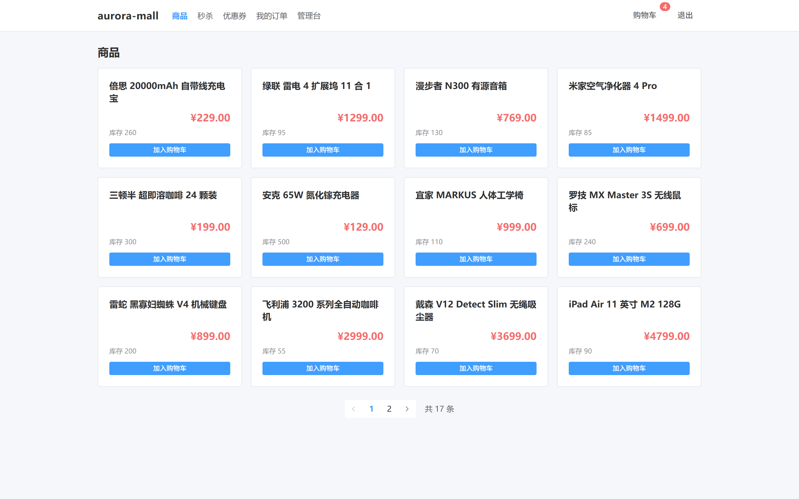
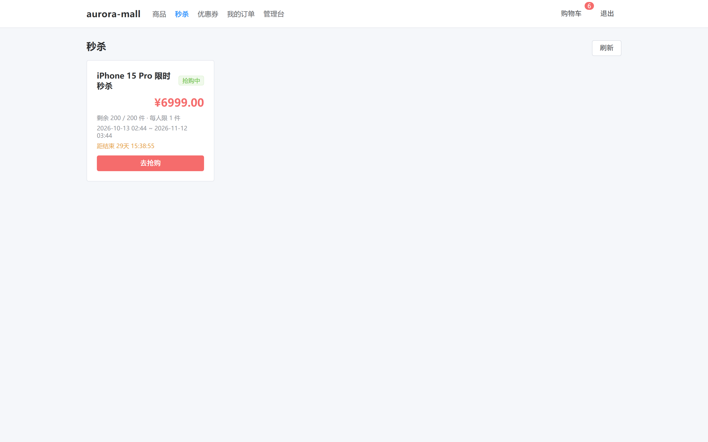
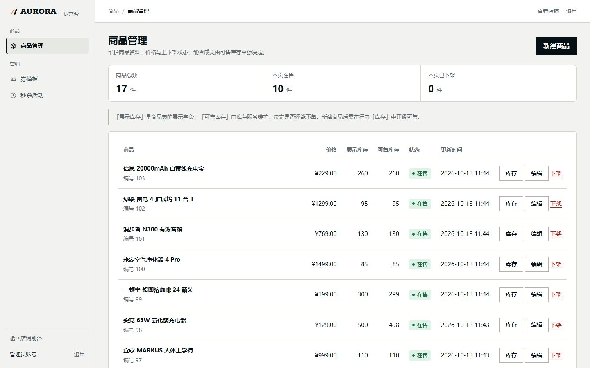
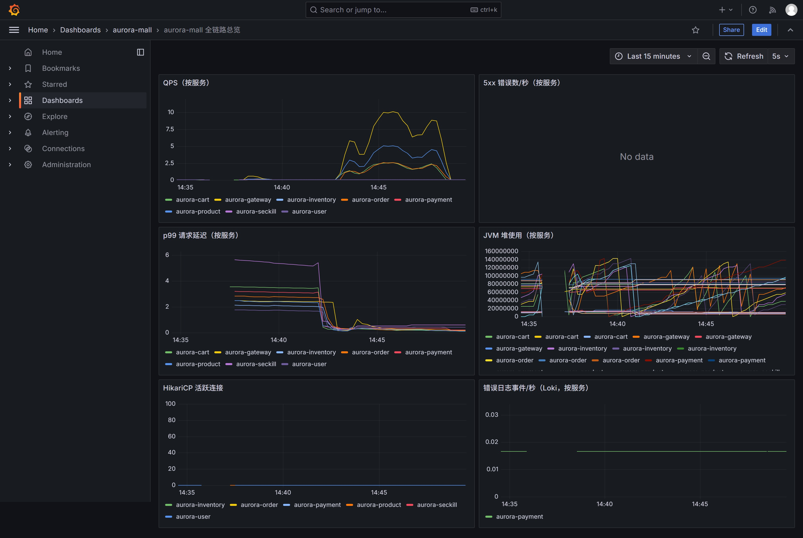

# aurora-mall

一个用于学习和验证分布式电商架构的 Java 微服务项目，包含用户端与管理端 Web 界面。交易链路覆盖下单、库存预留、支付回调和超时关单，并提供可切换的事务方案与自研分布式组件。

[](https://github.com/zeng-bohan/aurora-mall/actions/workflows/ci.yml)


支付使用模拟回调链路，不连接真实支付渠道。所有压测与对照数据都来自本机环境，具体口径见对应报告。

## 界面

<table>
  <tr>
    <td width="50%"></td>
    <td width="50%"></td>
  </tr>
  <tr>
    <td align="center">用户端：商品列表与搜索</td>
    <td align="center">用户端：秒杀活动</td>
  </tr>
  <tr>
    <td width="50%"></td>
    <td width="50%"></td>
  </tr>
  <tr>
    <td align="center">管理台：商品管理</td>
    <td align="center">可观测性：Grafana 全链路总览</td>
  </tr>
</table>

更多截图在 [docs/screenshots](docs/screenshots)。

## 功能

- 用户注册、登录、令牌刷新与登出。网关校验 JWT，登出会撤销令牌。
- 商品浏览与管理、购物车、单商品订单、优惠券领取与下单抵扣、模拟支付回调。
- 订单库存预留、RocketMQ 事务消息与延迟关单。订单事务可切换为 Seata AT 对照模式。
- 秒杀活动和异步下单。预扣由 Redis Lua 原子完成，落单交给 MQ 消费者。
- 缓存穿透保护：空值缓存、布隆过滤器、逻辑过期。
- 网关限流与熔断、请求幂等、业务补偿任务。
- 独立实现分布式 ID 生成器、限流/熔断组件和基于 Netty 的 RPC 组件。购物车到商品服务的调用可在 OpenFeign 与自研 RPC 之间切换，业务代码不变。
- Vue 3 用户端与管理台，Prometheus、Grafana、Loki、SkyWalking 可观测性配置。

## 架构

~~~mermaid
flowchart LR
    Web[Vue 用户端 / 管理台] --> GW[Spring Cloud Gateway<br/>JWT 校验 · 限流 · 内部路径守卫]
    GW --> S[用户 · 商品 · 购物车<br/>库存 · 支付 · 秒杀]
    GW --> O[订单服务]
    S --> N[Nacos 注册与配置]
    O --> N
    S --> DB[(MySQL，按服务分库)]
    O --> DB
    S --> R[(Redis)]
    O --> R
    O --> MQ[RocketMQ]
    O -. 可选事务对照 .-> SEATA[Seata AT]
    S --> OBS[Prometheus · Grafana · Loki · SkyWalking]
    O --> OBS
~~~

订单链路用 RocketMQ 事务消息和延迟消息实现最终一致：本地事务里写订单与 `tx_message`，事务消息确认以该行为锚；库存预扣走 Redis Lua，DB 扣减由消费者完成；超时关单由延迟消息触发，扫描任务兜底。

## 模块

Maven 父 POM 列出 14 个模块，其中 8 个是可独立启动的 Spring Boot 服务（网关 + 7 个业务服务），另有 1 个 Vue 前端。

| 路径 | 职责 |
| --- | --- |
| `aurora-gateway` | API 网关、JWT 校验、路由限流、内部路径守卫 |
| `aurora-user`、`aurora-product` | 用户与商品服务 |
| `aurora-cart`、`aurora-order` | 购物车与订单服务 |
| `aurora-inventory`、`aurora-payment`、`aurora-seckill` | 库存、模拟支付与秒杀服务 |
| `aurora-common`、`aurora-api` | 公共基础设施与服务契约 |
| `aurora-id-generator`、`aurora-ratelimit`、`aurora-rpc` | 分布式 ID、限流/熔断、Netty RPC |
| `aurora-sharding-pilot` | ShardingSphere 分库试点，不进入产品链路 |
| `aurora-web` | Vue 3 用户端与管理台 |
| `docker` | 本地中间件栈、建表 SQL、冒烟与演示脚本 |
| `docs` | 对照实验与压测报告、截图 |

## 环境要求

- JDK 21
- Maven 3.9 或更高版本
- Docker Compose
- Bash（Windows 可用 Git Bash）
- Node.js 22（只在构建或运行前端时需要）

## 快速开始

### 1. 启动基础设施

```bash
cd docker
docker compose up -d
bash smoke.sh
bash nacos/import.sh
```

`smoke.sh` 检查中间件是否就绪；`nacos/import.sh` 生成并复用被 Git 忽略的开发密钥，把应用配置写入 Nacos。**先完成导入再启动 Java 服务**，服务缺配置会直接启动失败。

中间件端口：MySQL `13306`、Redis `16379`、Nacos `8848`、RocketMQ `9876`，详细列表见 [docker/README.md](docker/README.md)。

### 2. 构建并启动后端

```bash
cd ..
mvn -B clean verify

for service in gateway user product cart order inventory payment seckill; do
  java -jar "aurora-$service/target/aurora-$service-0.1.0-SNAPSHOT.jar" &
done
wait
```

服务从 Nacos 读取运行配置。只调试单个服务时，在 IDE 里启动对应模块的 Spring Boot 应用即可。

### 3. 启动前端

```bash
cd aurora-web
npm ci
npm run dev
```

开发地址 `http://localhost:5173`，`/api` 代理到网关 `8000`。管理界面需要 ADMIN 角色，注册流程创建的是普通用户；演示管理员账号由 `bash docker/seed-demo.sh` 提供。

### 4. 验证

```bash
bash docker/smoke-services.sh   # 网关与各服务健康检查
bash docker/smoke-flows.sh      # 注册 → 登录 → 浏览 → 加购 → 改价收敛 → 登出
```

## 使用示例

所有业务请求经网关 `http://localhost:8000`：

| 功能 | 路径 |
| --- | --- |
| 注册、登录、续期、登出 | `/api/user/register`、`/api/user/login`、`/api/user/refresh`、`/api/user/logout` |
| 商品浏览与管理 | `/api/product/products`、`/api/product/admin/products` |
| 购物车 | `/api/cart/carts` |
| 订单与优惠券 | `/api/order/orders`、`/api/order/coupons/templates` |
| 秒杀 | `/api/seckill/activities`、`/api/seckill/activities/{id}/orders` |

```bash
TOKEN=$(curl -s -X POST http://localhost:8000/api/user/login \
  -H 'Content-Type: application/json' \
  -d '{"username":"admin","password":"..."}' | sed -E 's/.*"accessToken":"([^"]+)".*/\1/')

curl -s http://localhost:8000/api/product/products \
  -H "Authorization: Bearer $TOKEN"
```

请求模型与完整路由以各模块 Controller 和 [aurora-web/README.md](aurora-web/README.md) 为准。

## 测试

```bash
mvn -B clean verify      # 后端全模块构建与测试
cd aurora-web && npm run typecheck && npm run build
```

后端当前结果：395 个用例，0 失败，38 个跳过。跳过的用例需要真实 MySQL、Redis 或 Nacos，本机没起中间件时会自动跳过；这类用例包括 Redis Lua 库存脚本、券领取并发、秒杀 Lua、分库试点和 Nacos 注册。

测试分三类：

- 纯单元测试：编解码、负载均衡、熔断状态机、缓存策略、限流器，不依赖外部服务。
- Spring 上下文与 Web 层测试：网关过滤器、守卫过滤器、控制器参数校验。
- 真实中间件集成测试：用 Docker 起的 MySQL/Redis 验证 Lua 脚本与并发语义，缺环境时跳过。

CI 在 `ubuntu-24.04` 上跑 `mvn -B clean verify`，并单独构建前端、构建全部服务镜像。工作流不推送镜像。

## 工程证据

以下报告都来自实际运行，每一份写明了环境、方法、结果和复现命令。

| 报告 | 内容 |
| --- | --- |
| [docs/m2-tx-comparison.md](docs/m2-tx-comparison.md) | RocketMQ 最终一致 vs Seata AT：机制对比与回滚注入实测 |
| [docs/m3-rpc-comparison.md](docs/m3-rpc-comparison.md) | OpenFeign vs 自研 RPC：功能等价性证据、微基准、边界 |
| [docs/m4-load-test.md](docs/m4-load-test.md) | 同一购物车链路下两种传输的并发对照，含失败根因分析 |
| [docs/m5-seckill-load-test.md](docs/m5-seckill-load-test.md) | 秒杀在限流开/关两轮下的吞吐、一致性与限流证据 |
| [docs/m5-sharding-pilot.md](docs/m5-sharding-pilot.md) | ShardingSphere 分库试点：路由、分页、事务、唯一键 |
| [docs/TECHNICAL_HIGHLIGHTS.md](docs/TECHNICAL_HIGHLIGHTS.md) | 核心设计对应的代码位置、验证方式与已知限制 |

几个可以直接核对的结论：

- 秒杀压测两轮各 20 万级尝试，限量 3000 恰好成交 3000，DB 与 Redis 余量同时归零，没有残留 PENDING。
- 同一购物车链路，Feign 轮在 50 线程出现连接耗尽错误，100 线程吞吐回落；RPC 轮在 100 线程仍为零错误。报告里明确写了这条差异主要来自连接生命周期，不是序列化格式。
- Seata AT 回滚注入后，已提交的订单行被 undo_log 撤销，库存预占保持不变。

## 目录结构

```text
aurora-gateway/          网关
aurora-user/             用户
aurora-product/          商品（含缓存穿透保护）
aurora-cart/             购物车（Feign / RPC 可切换）
aurora-order/            订单（事务消息、关单、优惠券）
aurora-inventory/        库存（Lua 预扣、对账）
aurora-payment/          模拟支付
aurora-seckill/          秒杀
aurora-common/           公共基础设施
aurora-api/              服务契约
aurora-id-generator/     分布式 ID
aurora-ratelimit/        限流与熔断
aurora-rpc/              Netty RPC
aurora-sharding-pilot/   分库试点
aurora-web/              Vue 前端
docker/                  中间件栈与脚本
docs/                    报告与截图
```

## 配置与数据

仓库没有统一的 `.env.example`，本地基础地址与覆盖项见各服务的 `application.yml`。

| 变量 | 用途 |
| --- | --- |
| `NACOS_ADDR` | Nacos 地址 |
| `MYSQL_ADDR`、`MYSQL_PASSWORD` | MySQL 地址与密码 |
| `REDIS_HOST`、`REDIS_PORT` | Redis 连接 |
| `ROCKETMQ_ADDR` | RocketMQ NameServer |
| `AURORA_TX_MODE`、`SEATA_ENABLED`、`SEATA_ADDR` | 订单事务方案与 Seata 连接 |
| `AURORA_RPC_ENABLED`、`RPC_HOST`、`RPC_PORT` | 购物车到商品服务的 RPC 开关与监听配置 |
| `AURORA_SECKILL_ORDER_MODE` | 秒杀订单处理模式 |
| `VITE_GATEWAY` | 前端开发代理目标 |

建库与建表脚本在 [docker/mysql/init](docker/mysql/init)，由 MySQL 镜像在新建数据卷时执行。已有数据卷不会自动重跑初始化脚本。项目没有 Flyway/Liquibase 迁移流程，表结构变更需要手工处理。

`docker/nacos/import.sh` 生成的密钥保存在 `docker/nacos/.secrets.env`，已加入 `.gitignore`。

## 已知限制

- 订单模型是单商品订单。购物车多商品结算会分别生成多笔订单，优惠券只作用于单个订单。
- 支付是模拟链路，回调由服务端校验 HMAC 签名，但不对接真实渠道。
- Seata AT 只覆盖订单与库存两个分支，用于对照实验，不与 MQ 模式混跑同一 SKU。
- 自研 RPC 是单连接多路复用，大响应会阻塞小响应；没有实现 XID 透传，所以 AT 链路仍走 Feign。连接池化留待后续。
- 秒杀限流的 300 配额证据来自 Redis 窗口采样，入口被拒比例是按采样推导的，不是直接计数器。
- 压测数字来自单机环境（服务、中间件、压测器同机，每服务 256MB 堆），不代表生产容量，只适合同环境对照。
- 本地开发凭证和关闭认证的 Nacos 配置只用于开发，不能直接用于公网部署。

## 支持与反馈

问题与建议请提 [Issue](https://github.com/zeng-bohan/aurora-mall/issues)。报告 Bug 时请附复现步骤、服务日志和相关配置。

## 许可证

[MIT](LICENSE)
